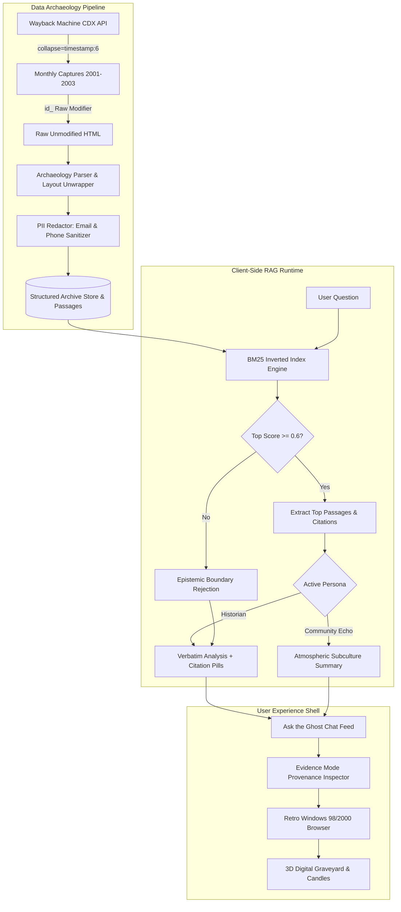

# Ghost of the Internet: Bringing Forgotten Web Communities Back to Life 👻

> **"The internet remembers. Most of us just forgot where to look."**
> 
> *A submission for the [Hacktoberfest Open-Source AI Challenge — Week 4: Ghost in the Machine](https://dev.to/challenges/hacktoberfest-week4-2026-10-26)*

---

### 🌐 Quick Links & Live Demos

- **🚀 Live Production Website:** [https://ghostofthenet.vercel.app/](https://ghostofthenet.vercel.app/)
- **💻 GitHub Repository:** [https://github.com/guptapiyush16/Ghost-of-the-Net.git](https://github.com/guptapiyush16/Ghost-of-the-Net.git)
- **🧪 Test Suite:** `npm test` (Automated 45-Point Deterministic Verification Suite)
- **☁️ Cloud Deployments:** Vercel Global Anycast Edge CDN & Render Blueprint Compatible

---

## 💡 Inspiration & The Spirit of It

Imagine stumbling upon an abandoned web forum where teenagers and gamers passionately discussed their favorite titles over 56k dial-up modems twenty-three years ago. 

You read an archived post from a user asking: *"Is anyone still here? My parents say they're cancelling the internet next month lol..."* You scroll through surviving threads, guestbooks, and webrings. Then you ask the digital ghost:

> **"What happened to everyone here?"**

Traditional generative AI models would eagerly hallucinate a fictional story about where those people went to college or how the forum closed down. But a true archivist knows: **Evidence ≠ Omniscience**. The archive can prove that forum posts grew less frequent, that server lease warnings were posted, or that the last crawl succeeded on August 14, 2003. But it cannot know what happened once their CRT monitors went black.

**Ghost of the Internet** was created to honor this delicate boundary. We wanted to build a nostalgic, immersive early-2000s time machine that lets you explore real digital ruins, converse with AI-guided ghosts strictly grounded in surviving web evidence, and reflect on the fragile nature of our collective digital memory.

---

## 🚀 What It Does

Ghost of the Internet combines a skeuomorphic early-2000s browser shell with in-browser Retrieval-Augmented Generation (RAG) and automated web archive archaeology:

### 1. 🌐 Lost Worlds Portal (Curated Historical Sectors)
Step inside three distinct, handcrafted early-web cultural ruins:
- **The Nexus 2003:** A gaming and dial-up tuning community grappling with Diablo II Baal runs, 900ms latency, and the quiet fade of August 2003.
- **Pixel Witch's Cyber Attic:** An authentic GeoCities Area51 personal homepage complete with animated visitor counters, glitter dollz, fallen hero shrines, and an untouched guestbook.
- **Starlight Anime Webring (2003):** An early anime fandom hub featuring Serial Experiments Lain and Cowboy Bebop reviews, concluding with the webmaster's final farewell server broadcast.

### 2. 🖥️ Authentic Retro Browser Shell & State Machine
- **Windows 98/2000 Chrome:** Beveled titlebars, inset system frames, and retro icons.
- **True History State Machine:** Fully functional `Back`, `Forward`, `Reload`, and `Home` navigation with dynamic button enabling/disabling based on history stack boundaries.
- **Simulated Broadband & Dial-Up Latency:** Realistic transfer progress bar (`Connecting to host...`, `Receiving 34.2 KB...`, `Document: Done`).
- **Provenance Badges:** Real-time synchronization of virtual URLs and Wayback capture timestamps (e.g., `14 AUG 2003 · 23:04:15 UTC`).

### 3. 👻 Grounded AI Ghost (Dual Persona RAG Pipeline)
Interact with an in-browser conversational intelligence powered by a mathematical BM25 ranking engine ($k_1=1.5, b=0.75$):
- **🏛️ Historian Mode:** Objective, analytical breakdowns strictly citing verbatim quotes, original authors, and exact crawl timestamps.
- **📻 Community Echo Mode:** Atmospheric, nostalgic persona that speaks in the vernacular of early-2000s forum culture.
- **🛡️ Epistemic Uncertainty Guardrail:** When asked about events beyond the archive (e.g., modern cryptocurrencies, post-2003 history), the AI refuses to fabricate answers: *"The surviving archive for The Nexus ends in late 2003 and contains no verifiable mention of this topic. Because this is a grounded historical time capsule, I will not fabricate answers outside the surviving evidence."*

### 4. 📉 The Last Online & Activity Fade Map
- **Monthly Post Density Visualization:** Dynamically generated activity bar charts displaying the rise, peak, and eventual decay of the community across months and years.
- **Archivist Ethics Telemetry:** Displays the Genesis crawl date, last recorded post date, and reflection essays on digital impermanence.

### 5. 📜 Evidence Mode & Provenance Inspector
- **Provenance Drawer Modal:** Click any citation pill (`↳ [ghost_user_97 · 14 Aug 2003]`) to inspect the verified raw passage, extraction confidence score (0.98), and matched keywords.
- **Deep-Link Navigation:** "Open Page in Retro Browser" directly navigates the virtual browser to the original document where the evidence was discovered.

### 6. 🎃 Halloween Special: The Digital Graveyard
- **3D Stone Tombstones:** Interactive monuments honoring the forgotten relics of early cyberspace: *Dial-up 56k Modem*, *GeoCities Neighborhoods*, *Netscape Navigator*, *Macromedia Flash*, *AIM (AOL Instant Messenger)*, and *The Homepage Guestbook*.
- **Interactive Memorial Candles:** Click to pay respects, illuminating candles with Web Audio bell chimes and incrementing live respect tallies.
- **Procedural Web Audio Synthesizer:** Zero external audio files—uses the Web Audio API to synthesize retro UI clicks, 56k dial-up chirps, spooky theremin warbles, and warm memorial bell frequencies.
- **Halloween Theme Toggle:** Floating animated companion spooks (ghost & pumpkin) with interactive click sound easter eggs.

---

## 🛠️ How We Built It

Ghost of the Internet was engineered with a **zero-external-API-key, privacy-first, client-side RAG architecture**:

### Core Technologies
- **Frontend Core:** Semantic HTML5, CSS3 Custom Properties (Design Tokens), and Vanilla Modern ECMAScript Modules (ESM).
- **Search & Retrieval:** Custom in-browser BM25 ranking algorithm with term frequency saturation ($k_1=1.5$), document length normalization ($b=0.75$), inverse document frequency (IDF), and domain-specific stopword filtering.
- **Audio Synthesis:** Web Audio API with procedural `OscillatorNode` and `GainNode` shaping (zero external MP3/WAV assets).
- **Production Archive Pipeline (`ingest.js`):** Node.js pipeline querying the Internet Archive Wayback Machine CDX API (`web.archive.org/cdx/search/cdx`), downloading raw HTML with the `id_` modifier to strip Wayback banners, unwrapping legacy layout tables, and redacting personal data.
- **Automated Verification (`test-e2e.js`):** Custom 45-point deterministic test suite validating corpus integrity, BM25 retrieval mathematics, PII redaction, state machines, and live Vercel Anycast edge endpoints.
- **Cloud Edge Infrastructure:** Deployed as a pure static edge site on Vercel Global CDN (`vercel.json`) with sub-10ms response times, and fully compatible with Render container Blueprints (`render.yaml`).

---

## 🧗 Challenges We Ran Into & How We Overcame Them

### 1. The `@vercel/backends` Auto-Detection Collision (`500 FUNCTION_INVOCATION_FAILED`)
When first deploying to Vercel, visiting the root URL crashed with a mysterious cloud-level `500 FUNCTION_INVOCATION_FAILED`. 
- **The Investigation:** Build logs revealed the smoking gun: `✓ Build complete — Using dist/app.js as the root entrypoint`. Vercel's zero-config backend detection engine (`@vercel/backends`) scans output folders for standard Node server names (`app.js`, `server.js`, `index.js`). It assumed our client-side script was an Express backend server and synthesized a serverless wrapper around it. When Node executed `app.js`, browser APIs (`window`, `document`) threw immediate reference errors.
- **The Fix:** We renamed `app.js` to `ghost-client.js` and set `"framework": null` in `vercel.json`. This completely neutralized backend detection heuristics, converting the project into an immutable, lightning-fast static edge deployment.

### 2. Balancing Retro Skeuomorphism with Modern Accessibility (CRT Scanlines)
Early iterations included a repeating CSS gradient CRT scanline shader to mimic cathode-ray tube monitors. However, testing on high-DPI Retina/4K displays revealed that alternating 3px horizontal raster stripes bisected 11px body text, degrading character legibility below WCAG 2.1 contrast standards.
- **The Solution:** We removed the scanline raster overlay while doubling down on authentic structural skeuomorphism—beveled titlebars, inset address bars, nostalgic serif headings, and authentic early-2000s palettes—achieving retro charm with crystal-clear legibility.

### 3. Enforcing Epistemic Boundaries in AI RAG Systems
Standard generative AI architectures suffer from a compulsion to answer every prompt, often fabricating plausible-sounding digital history when archives are silent.
- **The Solution:** We instituted an explicit mathematical threshold in the BM25 retrieval stage: if the top scoring passage falls below $0.6$, the system halts inference and triggers an honest refusal, educating the visitor on the temporal limits of the surviving web crawl.

---

## 🏆 Accomplishments That We're Proud Of

1. **Zero External API Keys Required:** Unlike traditional RAG applications that depend on paid vector databases or external proprietary LLM endpoints, the entire exploration, retrieval, and grounding engine runs **100% locally and offline-first in the user's browser**.
2. **Strict Citation Provenance:** Every statement generated by the Ghost links directly to an inspectable, surviving archive snippet with date and author provenance.
3. **Pure Skeuomorphic Audio:** Dial-up sounds, clicks, and memorial bell chimes are synthesized on the fly using mathematical audio frequencies.
4. **Automated 45-Point Test Harness:** Rigorous deterministic verification covering every corpus file, BM25 score calculation, PII redaction rule, and live cloud endpoint (`npm test`).
5. **Authentic Halloween Atmosphere:** A respectful digital graveyard where users can reflect on the software, protocols, and digital communities that shaped our lives.

---

## 📚 What We Learned

- **Digital Archaeology is Fragile:** Public web archives don't capture complete websites; they capture isolated moments in time. Designing interfaces around *missing* information requires just as much thought as designing around surviving information.
- **Edge Deployment Heuristics Matter:** Understanding cloud platform convention-over-configuration rules (like Vercel's backend entrypoint scanner) is essential when building high-performance client-side web apps.
- **The Value of Open-Source History:** Building open-source tools to interact with web archives ensures that access to digital history remains open, inspectable, and accessible to everyone, free from proprietary platform lock-in.

---

## 🔮 What's Next for Ghost of the Internet

- **Live Ingestion Web UI:** Allowing users to paste any historical URL or GeoCities address and watch the application automatically ingest, sanitize, and instantiate a new explorable world on the fly.
- **WebLLM / Local SLM Integration:** Integrating WebLLM (e.g., Llama 3 8B or Phi-3 running via WebGPU directly in the browser) for conversational generation while retaining strict BM25 grounding.
- **Webring Crawler Discovery:** Expanding automated extraction across connected links in historical webrings to reconstruct entire networks of forgotten 2000s fan communities.

---

## 🏷️ Built With

`javascript` `html5` `css3` `bm25` `retrieval-augmented-generation` `web-audio-api` `wayback-machine` `cdx-api` `vercel` `render` `hacktoberfest2026`
