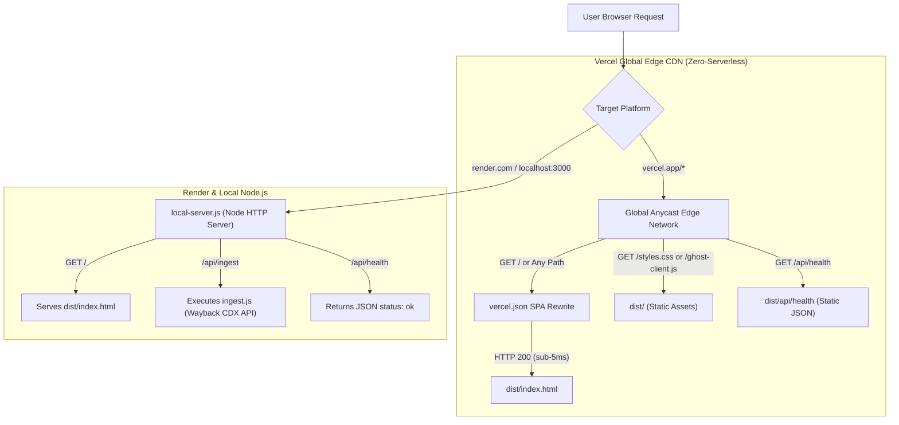

# Execution Flow Map (Flow.md)
Project: Ghost of the Internet (Hacktoberfest 2026 · Week 4)

This document visualizes and traces how runtime execution travels through the application across modules, user interactions, search/retrieval, AI synthesis, and the production Wayback Machine ingestion pipeline.

---

## Architectural Comparison: Naive Live Querying vs. CDX Index Pipeline

```mermaid
flowchart TD
    subgraph Scenario A: What Happens If We Just Query Live on Every User Click?
        U1[User opens URL: geocities.com/attic] --> N1[System has no timestamp - which year/date to fetch?]
        N1 --> N2[Wait 3-6s for archive.org redirect]
        N2 --> N3[Downloads raw uncleaned HTML with scripts and broken assets]
        N3 --> N4[User asks AI Ghost: 'Why did this forum fade?']
        N4 --> N5[FAILURE: AI cannot answer because it only has 1 page, not the community history!]
        N5 --> N6[To answer, AI would need to crawl 50 URLs live = 120s latency or HTTP 429 Rate Limit]
    end

    subgraph Scenario B: Production CDX Pipeline (Read-Through Cache Pattern)
        U2[User requests new website / collection] --> C1[Query Wayback CDX Index: 1 quick metadata call]
        C1 --> C2[CDX returns all capture timestamps across 1999-2004]
        C2 --> C3[Calculate Activity Fade Map instantly from timestamps]
        C3 --> C4[Fetch top N snapshots in parallel, clean HTML, redact PII]
        C4 --> C5[Build In-Memory / SQLite BM25 Search Index]
        C5 --> C6[User browses pages with instant sub-millisecond switching]
        C6 --> C7[AI Ghost answers queries in 500ms using grounded multi-page evidence]
    end
```

---

## Detailed High-Level Execution Architecture

```mermaid
flowchart TD
    subgraph Production Real Web Ingestion Flow (ingest.js / POST /api/ingest)
        WA[User or CLI requests URL & Date Range e.g. info.cern.ch 1997-2003] --> WB[Query Wayback Machine CDX API]
        WB --> WC[Filter: statuscode 200, mimetype text/html, collapse timestamp:6]
        WC --> WD[Iterate Snapshots: Fetch Raw Payload with id_ modifier]
        WD --> WE[Archaeology Parser: Strip Scripts, Styles, Tables, & PII Redaction]
        WE --> WF[Extract Text Passages, Compute Monthly Activity Timeline]
        WF --> WG[Package as Lost World JSON / Inject into Archive Store]
    end

    subgraph User Exploration Loop
        A[User Enters Web App] --> B[Server serves index.html, styles.css, ghost-client.js, archiveData.js]
        B --> C[ghost-client.js Initializes]
        C --> D[Hydrate archiveWorlds & Build In-Memory BM25 Index]
        C --> E[Mount Retro Browser Shell & Render Default World]
        WG -.-> D
    end

    subgraph Feature 2: Retro Browser State Machine
        I[User Interacts with Page or Toolbar] --> J{Action Type}
        J -->|Click Page Link| K[Push New State to historyStack & Increment historyIndex]
        J -->|Click Back Button| L[Decrement historyIndex & Retrieve Target State]
        J -->|Click Forward Button| M[Increment historyIndex & Retrieve Target State]
        J -->|Click Reload Button| N[Trigger CRT Flicker & Re-simulate Transfer]
        K --> O[simulatePageTransfer: Progress Bar & Status Text Updates]
        L --> O
        M --> O
        N --> O
        O --> P[Render Specialized World View: Forum / GeoCities / Fan Hub]
    end

    subgraph Feature 3: Grounded AI Ghost (RAG Pipeline)
        Q[User Submits Query via #ghostQuestion] --> R[BM25SearchEngine.search: Tokenize & Calculate Term Scores]
        R --> S{Best Score >= Threshold 0.6?}
        S -->|Yes: Passages Found| T[Ground Response in Best Passages with Author, Date, Quotes]
        S -->|No: Unrecorded / OOD| U[Trigger Epistemic Boundary Fallback: Honest Uncertainty]
        T --> V{Active Mode}
        V -->|Historian| W[Synthesize Objective Factual Analysis]
        V -->|Community Echo| X[Synthesize Atmospheric Nostalgic Summary]
        W --> Y[Render Response with Clickable Citation Pills]
        X --> Y
        U --> Y
    end

    subgraph Feature 4: The Last Online & Activity Fade Map
        Z[User Navigates to Last Online Tab] --> AA[Read Active World Timeline Array]
        AA --> AB[Render Dynamic Density Bar Chart]
        AB --> AC[Display Genesis Date vs Last Recorded Post & Archivist Reflection]
    end

    subgraph Feature 5: Evidence Mode & Provenance Inspector
        AD[User Clicks Any Citation Pill or Source Button] --> AE[openEvidenceModal: Retrieve Passage by ID]
        AE --> AF[Display Exact Verbatim Quotation, Author, Date, Confidence Score]
        AF --> AG[Provide 'Open Page in Retro Browser' Deep-Link Action]
    end
```

---

## Detailed Step-by-Step Function Execution Traces

### 1. Production Wayback Extraction Pipeline (`ingest.js`)
1. **CDX Search**: `queryWaybackCDX(targetUrl, fromYear, toYear, limit)`
   - Sends query to `https://web.archive.org/cdx/search/cdx`.
   - Collapses captures to 1 per month (`collapse=timestamp:6`) to avoid duplicate crawls and reveal natural activity decay.
2. **Raw HTML Retrieval**: `fetchRawSnapshot(timestamp, originalUrl)`
   - Uses `https://web.archive.org/web/${timestamp}id_/${originalUrl}`.
   - The `id_` suffix strips out all Wayback Machine header banners, analytics, and injected rewrite code.
3. **Archaeological Sanitization & PII Filter**: `extractTextAndMetadata(html, url, timestamp)`
   - Purges `<script>`, `<style>`, `<head>`, `<noscript>`.
   - Converts archaic layout tables and linebreaks into clean semantic blocks.
   - Masks sensitive personal data: replaces emails with `[email-redacted]` and phone numbers with `[phone-redacted]`.
4. **World Formation**:
   - Compiles monthly snapshot frequency into an activity timeline array (`timeline: [ { month, posts, pct } ]`).
   - Extracts 150-word searchable chunks with keywords into `passages`.
   - Returns structured `LostWorld` object ready for BM25 indexing.

### 2. Virtual Browser History Transition (`navigateTo(worldId, pageId, pushHistory)`)
- Updates `state.currentWorldId` and `state.currentPageId`.
- Truncates and pushes to `historyStack` when navigating anew.
- Updates browser toolbar buttons (`#btnBack`, `#btnForward`), address bar, snapshot datestamp ribbon, and status bar.
- Runs `simulatePageTransfer`: Animates `#browserProgressBar` through simulated network latency stages (`Connecting... Transferring... Done`).

### 3. Ghost Query & Grounding Execution (`generateGhostResponse(question, mode)`)
- Computes top 3 passages via `searchEngine.search()`.
- Evaluates epistemic boundary: if no results or top score $< 0.6$, rejects fabrication and reports the date boundaries of surviving archives.
- Synthesizes response in **Historian Mode** (objective with quotes) or **Community Echo Mode** (atmospheric subculture tone).
- Injects typewriter streaming indicator and outputs result into `#chatFeed`.

---

### 4. Cloud Edge Routing & Static Delivery Architecture (Vercel vs. Render vs. Local)



- **Vercel Pure Static Flow**: All requests are served directly from edge points of presence (PoPs) without spinning up cold lambdas or serverless functions. This eliminates `FUNCTION_INVOCATION_FAILED` entirely.
- **Render & Local Server Flow**: `local-server.js` maintains full Node runtime capabilities including dynamic archive ingestion via `ingest.js` and health monitoring.


